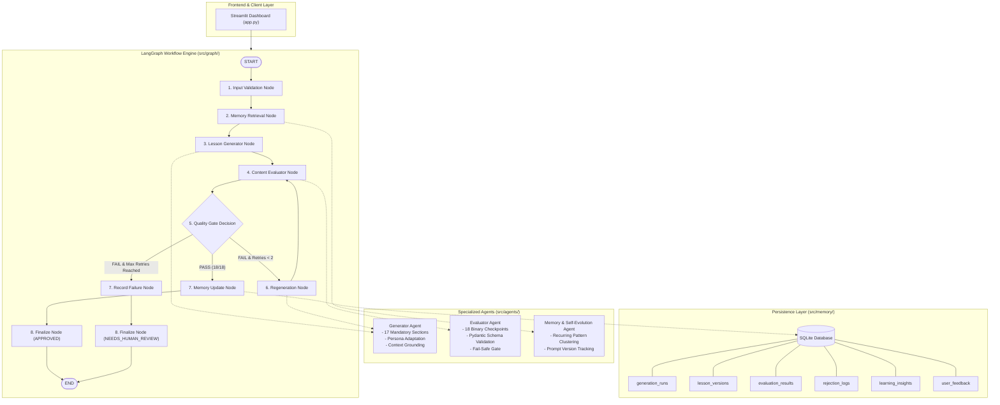

# LessonForge AI — Self-Evaluating Learning Content Generator

[](https://python.org)
[](https://github.com/langchain-ai/langgraph)
[](https://groq.com)
[](docs/TESTING_REPORT.md)
[](LICENSE)

An enterprise-grade, agentic educational content generator with closed-loop self-evaluation and bounded regeneration. LessonForge AI transforms complex technical concepts into self-contained, beginner-friendly lessons tailored for non-native English learners, rigorously verified against an uncompromising **18-checkpoint binary quality rubric**.

---

## 1. Project Overview & Problem Statement

### The Problem
Most educational content generation systems rely on a single, unverified LLM inference pass. This creates major risks:
- **Unchecked Hallucinations**: Technical concepts (such as embeddings or vector indexing) are often mischaracterized.
- **Cognitive Overload**: Unexplained technical jargon is dropped into beginner lessons, alienating learners.
- **Superficial Evaluations**: Many systems use cosmetic score-averaging (e.g. "82% overall"), which masks catastrophic pedagogical failures.

### The Solution: LessonForge AI
LessonForge AI replaces one-shot prompting with an autonomous, cyclic **Generator-Critic feedback loop** orchestrated by **LangGraph**:
1. **Grounded Synthesis**: Produces complete 17-section educational lessons grounded in authoritative academic literature (Lewis et al. 2020 NeurIPS RAG paper).
2. **Independent Hard-Gate Auditor**: An isolated evaluation agent subjects the lesson to **18 explicit binary checkpoints** across 6 quality dimensions.
3. **Bounded Intelligent Regeneration**: Any failed checkpoint triggers targeted failure extraction, remediation suggestions, and full revision (maximum 2 retries, 3 total generations).
4. **Persistent Memory & Continuous Evolution**: An ACID-compliant SQLite memory layer records all versions, rejection audits, and user feedback, automatically extracting recurring failure patterns to guide future generations.

---

## 2. System Architecture



---

## 3. Technology Stack

- **Orchestration**: LangGraph 1.2+ (StateGraph cyclic workflow)
- **Language Models**: Groq Cloud API (`llama-3.3-70b-versatile` default, `llama-3.1-8b-instant`)
- **Data Validation & Schemas**: Pydantic v2.11+
- **Frontend Dashboard**: Streamlit 1.37+
- **Persistence & Memory**: SQLite3 with relational tables and foreign keys
- **Environment & Config**: python-dotenv, Pydantic Settings
- **Testing & Verification**: Pytest 7.4+ with deterministic offline mocking

---

## 4. The 18-Checkpoint Evaluation Rubric

Every lesson is evaluated against 18 explicit binary checkpoints. **A single FAIL fails the entire generation**:

| Dimension | Checkpoint ID | Checkpoint Name | Core Pass Criteria |
|---|---|---|---|
| **A. Technical Accuracy & Grounding** | `ACC_01` | Topic Definition Accuracy | Precise definition of RAG (retrieval, augmentation, generation). |
| | `ACC_02` | Mechanism Accuracy | Accurately describes chunking, vector embedding, and context injection. |
| | `ACC_03` | Non-Misleading Claims | Acknowledges hallucination risks and real-world trade-offs. |
| | `ACC_04` | Grounded Factual Claims | Matches authoritative literature (Lewis et al. 2020). |
| **B. Beginner-Friendly Language** | `BEG_01` | Zero Prior Knowledge Baseline | Assumes zero computer science or programming background. |
| | `BEG_02` | Appropriate Vocabulary | Short sentences in simple English for non-native learners. |
| | `BEG_03` | Accessible Concept Translation | Translates embeddings and vectors into plain everyday terms. |
| | `BEG_04` | No Unnecessary Prerequisites | Teaches concepts cleanly without requiring terminal setup or coding. |
| **C. Teaching Through Examples** | `EXA_01` | Relatable Everyday Analogy | Vivid analogy (e.g. student consulting college handbook). |
| | `EXA_02` | Step-by-Step Walkthrough | Follows query → retrieval → augmentation → answer generation. |
| | `EXA_03` | Reinforcing Educational Examples | Directly clarifies why each pipeline component is needed. |
| **D. Clarity & Jargon Management** | `CLR_01` | Immediate Jargon Demystification | Every technical term explained immediately upon first mention. |
| | `CLR_02` | Self-Contained Comprehension | Student never needs to search external websites. |
| | `CLR_03` | Avoidance of Complexity | Concise paragraphs without circular definitions or filler. |
| **E. Coverage & Completeness** | `COV_01` | Comprehensive Concept Coverage | Covers what, why, chunking, embeddings, vector DB, prompt injection. |
| | `COV_02` | Triad of What, Why, and How | Dedicated sections addressing all three dimensions. |
| | `COV_03` | Practical Tradeoffs & Summary | Covers applications, limitations, summary, and knowledge check quiz. |
| **F. Coherent Teaching Flow** | `FLO_01` | Logical Progression | Intuition → High-level concept → Mechanical components → Quiz. |

---

## 5. Mandatory 17 Lesson Sections

The Generator Agent ensures that every generated lesson contains the following 17 numbered sections in order:
1. Lesson Title
2. Learning Objectives
3. Prerequisites (Zero prior knowledge)
4. Introduction
5. What Is This Concept?
6. Why Is It Important?
7. How Does It Work?
8. Step-by-Step Explanation
9. Real-World Example
10. Technical Example or Simple Analogy
11. Key Components
12. Practical Applications
13. Common Misconceptions
14. Summary
15. Key Terms Explained
16. Knowledge Check / Quiz (with MCQs)
17. Answers to the Quiz (with explanations)

---

## 6. Directory Structure

```text
lessonforge-ai/
├── app.py                     # Main Streamlit application
├── requirements.txt           # Project dependencies
├── README.md                  # Comprehensive documentation
├── .env.example               # Environment template
├── .gitignore                 # Version control ignores
│
├── src/
│   ├── agents/
│   │   ├── generator.py       # Lesson synthesis & targeted revision agent
│   │   ├── evaluator.py       # Independent 18-checkpoint quality auditor
│   │   └── memory_agent.py    # Memory & pattern evolution coordinator
│   │
│   ├── graph/
│   │   ├── state.py           # TypedDict LangGraph workflow state
│   │   ├── nodes.py           # Implementation of 8 workflow nodes
│   │   └── workflow.py        # LangGraph StateGraph assembly and cyclic routing
│   │
│   ├── evaluation/
│   │   ├── schemas.py         # Pydantic models for evaluation reports & checkpoints
│   │   ├── rubric.py          # 18-checkpoint definitions across 6 dimensions
│   │   └── validators.py      # Strict schema & hard-gate validation logic
│   │
│   ├── memory/
│   │   ├── database.py        # SQLite schema initialization & connection manager
│   │   ├── repository.py      # CRUD repository for runs, versions, evaluations, feedback
│   │   └── learning.py        # Self-evolution engine for failure pattern clustering
│   │
│   ├── services/
│   │   ├── llm_service.py     # BaseLLMClient abstraction, Groq client & Mock client
│   │   ├── grounding_service.py # Authoritative local RAG reference retrieval
│   │   └── export_service.py  # Markdown and audit JSON export packaging
│   │
│   ├── prompts/
│   │   ├── generator_prompt.py # Initial generation prompt template
│   │   ├── evaluator_prompt.py # Strict adversarial audit prompt template
│   │   └── regeneration_prompt.py # Structured delta revision prompt template
│   │
│   ├── ui/
│   │   ├── dashboard.py       # High-level KPIs and failure frequency charts
│   │   ├── generation.py      # Topic input, learner profile & live execution status
│   │   ├── evaluation.py      # 18-checkpoint evaluation report viewer
│   │   ├── history.py         # Version comparison & rejection log audit trail
│   │   └── memory.py          # Continuous learning insights & user feedback
│   │
│   └── config/
│       └── settings.py        # Centralized settings & learner persona configuration
│
├── data/
│   └── references/            # Grounding reference documents (Lewis et al. 2020)
│
├── tests/
│   ├── test_generator.py      # Generator unit tests
│   ├── test_evaluator.py      # Strict hard-gate and schema tests
│   ├── test_workflow.py       # LangGraph routing and input validation tests
│   ├── test_memory.py         # SQLite persistence and self-evolution tests
│   ├── test_retry_logic.py    # 1-pass, 2-pass, and bounded retry ceiling tests
│   └── test_integration.py    # End-to-end full lifecycle integration tests
│
├── docs/
│   ├── PROJECT_PLAN.md        # Comprehensive requirement breakdown
│   ├── ARCHITECTURE.md        # Detailed architecture and state machine specifications
│   ├── EVALUATION_RUBRIC.md   # Official 18-checkpoint rubric specification
│   ├── TECHNICAL_DECISIONS.md # Architectural trade-off analysis
│   ├── TESTING_REPORT.md      # Pytest execution results and matrix
│   └── DEMO_SCRIPT.md         # 3-5 minute video walkthrough script
│
└── exports/                   # Output directory for Markdown and JSON artifacts
```

---

## 7. Installation & Setup

### Prerequisites
- Python 3.11 or 3.12 installed.
- (Optional) A Groq Cloud API Key from [console.groq.com](https://console.groq.com).

### Step 1: Clone or Navigate to Project
```bash
cd lessonforge-ai
```

### Step 2: Install Dependencies
```bash
python -m pip install -r requirements.txt
```

### Step 3: Configure Environment Variables
Copy `.env.example` to `.env`:
```bash
cp .env.example .env
```
Edit `.env` and set your `GROQ_API_KEY`:
```ini
GROQ_API_KEY=gsk_your_groq_api_key_here
GROQ_MODEL=llama-3.3-70b-versatile
```
*(Note: You can also launch the app in Offline/Mock Mode or enter your Groq API key directly in the Streamlit sidebar!)*

---

## 8. Running the Application

Launch the Streamlit dashboard:
```bash
streamlit run app.py
```
Open your browser at `http://localhost:8501`.

### Operating Modes:
1. **Live Groq Mode**: Supply your API key in `.env` or in the sidebar. Inference runs at ultra-fast speeds using `llama-3.3-70b-versatile`.
2. **Offline / Mock Mode**: Toggle the checkbox in the sidebar. The workflow executes deterministically using `MockLLMClient`, perfect for testing or demonstrating without internet access.

---

## 9. Running Automated Tests

Run the full automated test suite with pytest:
```bash
python -m pytest tests/ -v
```

All 19 tests will execute deterministically in ~3 seconds with zero external network calls:
```text
tests/test_evaluator.py::test_evaluator_all_pass PASSED
tests/test_evaluator.py::test_strict_pass_fail_single_failure_fails_all PASSED
tests/test_evaluator.py::test_malformed_evaluator_output_safe_handling PASSED
tests/test_evaluator.py::test_missing_checkpoints_treated_as_fails PASSED
tests/test_evaluator.py::test_deterministic_lesson_checks PASSED
tests/test_generator.py::test_generator_creates_complete_lesson PASSED
tests/test_generator.py::test_regeneration_agent_receives_feedback PASSED
tests/test_integration.py::test_full_lifecycle_integration PASSED
tests/test_memory.py::test_persistent_memory_survives_restart PASSED
tests/test_memory.py::test_learning_from_failures_and_insights PASSED
tests/test_memory.py::test_user_feedback_persistence PASSED
tests/test_memory.py::test_version_history_retention PASSED
tests/test_memory.py::test_export_service PASSED
tests/test_retry_logic.py::test_scenario_1_first_attempt_passes PASSED
tests/test_retry_logic.py::test_scenario_2_first_fails_second_passes PASSED
tests/test_retry_logic.py::test_scenario_3_two_regenerations_required_then_passes PASSED
tests/test_retry_logic.py::test_scenario_4_and_5_all_attempts_fail_enforces_retry_ceiling PASSED
tests/test_workflow.py::test_input_validation_rejection_on_empty_topic PASSED
tests/test_workflow.py::test_routing_functions PASSED

19 passed in 2.88s
```

---

## 10. Demonstrating the Agentic Feedback Loop

1. Navigate to **✍️ Generate Lesson**.
2. Select Topic: `Introduction to RAG (Retrieval-Augmented Generation)`.
3. Set Max Retries to `2`.
4. Click **Start Agentic Generation & Evaluation Workflow**.
5. Watch the stage tracker:
   - Attempt 1 generates initial text.
   - Evaluator audits 18 checkpoints.
   - If any checkpoint fails, the Rejection Log records the failure, and the Regeneration engine triggers automatically.
   - The revised lesson is re-audited.
6. Check **⚖️ Evaluation Dashboard** to inspect citations and evidence for every checkpoint.
7. Check **🛑 Rejection Log** to see reasons and suggestions from failed iterations.
8. Check **📖 Final Lesson Viewer** to inspect the approved lesson and download Markdown / JSON audit artifacts.
9. Check **🧠 Memory & Learning** to see recurring failure patterns and active self-evolution insights.

---

## 11. Known Limitations & Future Improvements

- **Grounding Scope**: Currently curated for RAG and core Generative AI architectures. Future iterations can connect dynamic external web scrapers or ArXiv API loaders.
- **Multi-Modal Visuals**: Future versions can generate Mermaid flowcharts dynamically embedded into the generated lesson markdown.
- **Multi-Model Cross-Auditing**: The system can support multi-model evaluation ensembles (e.g. evaluating with LLaMA 3.3 70B and Claude 3.5 Sonnet in parallel).

---

## 12. License
MIT License. Developed for the GenAI Take-Home Assessment.
