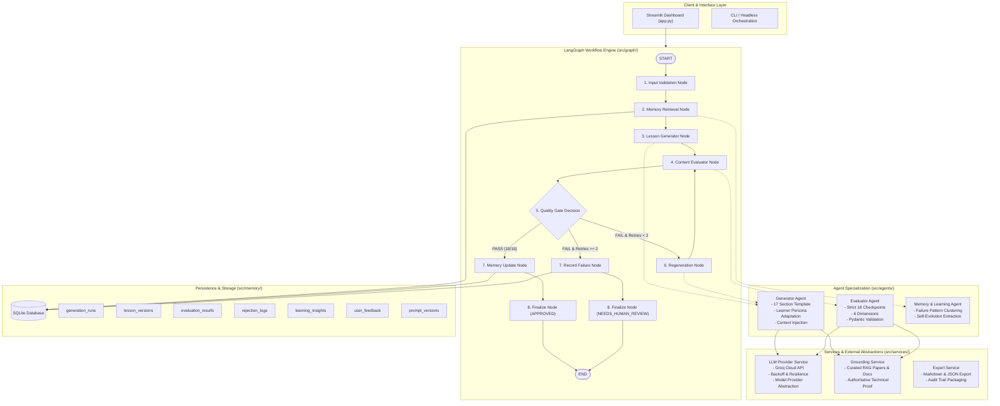

# LessonForge AI — System Architecture

## 1. Architectural Overview

LessonForge AI is built upon an autonomous multi-stage agentic feedback loop orchestrated by **LangGraph**. The design pattern embodies a **Dual-Agent Generator-Critic** architecture coupled with a **Persistent Episodic and Semantic Memory** store.



---

## 2. LangGraph State Management

The core state passed between nodes is governed by the `LessonForgeState` typed dictionary / Pydantic schema:

```python
class LessonForgeState(TypedDict):
    # Run configuration
    run_id: str
    topic: str
    learner_profile: dict
    max_retries: int
    current_attempt: int  # 1-indexed (1, 2, 3)

    # Context & Grounding
    reference_excerpts: list[str]
    memory_insights: list[str]

    # Working artifacts
    current_lesson: str
    previous_lessons: list[dict]  # list of {attempt, lesson_content, timestamp}
    
    # Evaluation artifacts
    evaluation_result: dict | None  # EvaluationReport
    failed_checkpoints: list[dict]
    feedback_for_regeneration: str
    rejection_history: list[dict]

    # Final outputs
    final_status: str  # "APPROVED" | "NEEDS_HUMAN_REVIEW" | "FAILED_INPUT"
    final_lesson: str | None
    execution_log: list[str]
```

### State Transitions and Invariants
1. **Attempt Bounds**: `current_attempt` starts at `1`. Increment occurs in `Regeneration Node`. An invariant `current_attempt <= max_retries + 1` is strictly enforced.
2. **Immutability of History**: `previous_lessons` and `rejection_history` append state entries on every cycle, preserving the full audit trail.
3. **No Overwrite on Failure**: If attempt 3 fails, `final_lesson` contains the latest attempt's lesson, but `final_status` is explicitly set to `"NEEDS_HUMAN_REVIEW"`. Under no circumstances is content marked `"APPROVED"` without an 18/18 evaluation report.

---

## 3. Node Responsibilities

### 1. `input_validation_node`
- Sanitizes topic string, verifies minimum and maximum length bounds (3–200 characters).
- Checks learner profile against persona schema.
- Rejects empty, nonsensical, or prompt-injection attempts.

### 2. `memory_retrieval_node`
- Queries SQLite database for:
  - Lessons generated for the same or semantically related topics.
  - Active `learning_insights` derived from previous rejection logs (e.g., "Learners struggle with vector database terminology without visual analogies").
  - Past user feedback trends.
- Injects synthesized guidance into the prompt context for the generator.

### 3. `lesson_generator_node`
- Pulls grounded excerpts from the Grounding Service (`data/references/`).
- Employs the default or configured learner persona:
  - Non-English-medium 12th-grade Indian graduate starting an AI career.
- Renders all 17 mandatory sections, explaining every technical term immediately upon introduction with everyday analogies (e.g., a student searching a college prospectus or library index cards).

### 4. `content_evaluator_node`
- Executes an independent critique call using a dedicated prompt and strict JSON schema.
- Evaluates the current lesson against the 18 binary checkpoints across 6 dimensions.
- Validates the JSON output against `EvaluationReport` Pydantic model. If the output fails validation, attempts programmatic recovery or fails safe.

### 5. `quality_gate_decision` (Conditional Edge)
- Inspects `evaluation_result.overall_status`.
- If `PASS`: routes to `memory_update_node`.
- If `FAIL` and `current_attempt <= max_retries`: routes to `regeneration_node`.
- If `FAIL` and `current_attempt > max_retries`: routes to `record_failure_node`.

### 6. `regeneration_node`
- Formulates targeted delta instructions:
  - Highlights specific failed checkpoint IDs (e.g., `BEG_02`, `ACC_04`).
  - Provides evaluator's cited evidence and concrete suggestions.
  - Commands the generator to retain well-received sections while repairing the defective parts.
- Increments `current_attempt`.

### 7. `memory_update_node`
- Records run record in `generation_runs`.
- Stores every lesson version in `lesson_versions`.
- Stores individual checkpoint evaluations in `evaluation_results`.
- If rejections occurred, stores detailed reasons in `rejection_logs`.
- Invokes the self-evolution engine to identify repeating failure patterns and update `learning_insights`.

### 8. `finalize_node`
- Prepares final presentation artifacts, Markdown download bundle, and audit JSON bundle.
- Emits execution telemetry.

---

## 4. Model Provider & Grounding Layer
- **Model Provider Abstraction**: Interface `BaseLLMClient` with implementations:
  - `GroqLLMClient`: Native high-throughput client using Groq's official SDK or `langchain-groq`.
  - `MockLLMClient`: Deterministic mock provider for unit and integration testing without network calls.
- **Grounding Layer**: Authoritative local documents:
  - Lewis et al., *Retrieval-Augmented Generation for Knowledge-Intensive NLP Tasks* (NeurIPS 2020).
  - LangChain Documentation on Vectorstores, Embeddings, and Chunking.
  - Vector search mathematical fundamentals explained conceptually.
