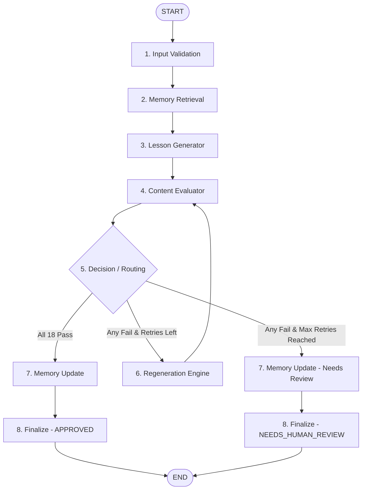

# LessonForge AI — Project Plan & Requirement Analysis

## 1. Executive Summary
**LessonForge AI** is an enterprise-grade agentic learning content generator with an independent, hard-gate self-evaluation engine and closed-loop regeneration feedback. The system is designed to generate complete, high-quality, beginner-friendly educational lessons (default: *Introduction to Retrieval-Augmented Generation (RAG)*) tailored to a specific learner profile (a 12th-grade graduate from India with limited English vocabulary, non-technical background, aspiring to enter AI).

The core technical philosophy of LessonForge AI is **verifiable agentic iteration**: rather than relying on a single LLM generation with superficial metrics, the system implements a strict, 18-checkpoint binary evaluation rubric (PASS/FAIL only). Any failure triggers an automatic extraction of root causes, targeted suggestions, and bounded regeneration (maximum 2 retries; 3 total generation attempts), backed by persistent SQLite application memory and self-evolution insights that survive application restarts.

---

## 2. Requirement Breakdown

### 2.1 Functional Requirements (FR)
- **FR-1: Input Validation**: Topic and learner profile validation, ensuring prompt safety, length boundaries, and sensible defaults.
- **FR-2: Grounded Technical Context**: Curated reference collection on Retrieval-Augmented Generation (Lewis et al. 2020 RAG paper, LangChain architectures, Vector Database mechanics) used to ground facts.
- **FR-3: Structured Lesson Generation**: Production of 17 mandatory lesson sections in beginner-friendly, accessible English with relatable real-world analogies (e.g., student consulting a college handbook).
- **FR-4: Independent Quality Evaluation**: Separation of concerns between the Generator and the Evaluator. Structured Pydantic schema enforcing binary evaluation (PASS/FAIL) across 18 explicit checkpoints across 6 dimensions.
- **FR-5: Strict Hard Gate**: If even one checkpoint fails, the overall status is `FAIL`. Zero partial credit or score averaging.
- **FR-6: Regeneration Engine**: Failed checkpoints, evidence, reasons, and actionable suggestions are bundled into structured feedback. The generator revises the lesson while preserving correct sections. Bounded strictly to 2 retries (3 total attempts).
- **FR-7: Persistent Memory & Evolution**: SQLite database tracking runs, versions, evaluation results, rejection logs, user feedback, and learned insights. Recurring failures automatically generate persistent guidance for future generation runs.
- **FR-8: Professional Streamlit UI**: Multi-tab interface featuring Dashboard Overview, Live Agent Workflow tracker, Evaluation breakdown, Version diffs/rejection log, Lesson viewer with Markdown/JSON export, History inspection, and Memory & Learning analytics.
- **FR-9: Model & Provider Abstraction**: Configurable Groq Cloud model (`llama-3.3-70b-versatile` default, fallback `llama-3.1-8b-instant`), with extensible interface for alternative providers. Zero hardcoded API keys.

### 2.2 Non-Functional Requirements (NFR)
- **NFR-1: Reliability & Guaranteed Termination**: The workflow is a bounded Directed Acyclic Graph (DAG) in LangGraph with explicit iteration counters. It is impossible to enter an infinite loop.
- **NFR-2: Observability & Auditability**: Every attempt, prompt input, LLM response, evaluation JSON, and user feedback entry is persisted in SQLite with timestamps and run IDs.
- **NFR-3: Determinism in Testing**: Full pytest test suite with mocked LLM and memory components, ensuring 100% reproducible testing offline without live API credentials.
- **NFR-4: Security & Safety**: Environment-based credentials via `.env`, parameterized SQL queries, clean separation of secrets, zero leakage in client outputs or logs.
- **NFR-5: Responsive UX**: Real-time status indication during multi-step LangGraph execution, preventing frozen UI experiences.

---

## 3. System Components & Responsibilities

| Component | Module | Responsibility |
|---|---|---|
| **Config & Settings** | `src/config/settings.py` | Environment variable parsing, Pydantic Settings, model configuration, thresholds. |
| **Model Abstraction** | `src/services/llm_service.py` | Unified LLM interface, Groq API client with exponential backoff, token tracking, fallback handling, mockable provider. |
| **Grounding Service** | `src/services/grounding_service.py` | Manages reference docs in `data/references/`, provides factual extracts for RAG topics to grounding prompts. |
| **Lesson Generator Agent** | `src/agents/generator.py` | Synthesizes comprehensive 17-section lessons from topic, learner profile, grounding docs, memory insights, and rejection feedback. |
| **Content Evaluator Agent** | `src/agents/evaluator.py` | Strictly audits lesson against 18 checkpoints in 6 dimensions; outputs validated Pydantic evaluation report. |
| **Memory & Learning Engine** | `src/memory/` | SQLite repository, schema migrations, runs/versions/feedback storage, pattern analyzer for failure modes. |
| **Workflow Orchestrator** | `src/graph/` | LangGraph StateGraph connecting 8 nodes: Validation, Memory Retrieval, Generator, Evaluator, Routing Decision, Rejection Logger, Regeneration, Memory Update, and Finalization. |
| **Streamlit Interface** | `src/ui/` & `app.py` | Polished dashboard with real-time graph event monitoring, evaluation badges, rejection logs, and lesson export. |

---

## 4. LangGraph Workflow Architecture

---

## 5. Implementation Roadmap & Milestones

1. **Phase 1: Requirements & Architecture Documentation** (Completed)
   - `docs/PROJECT_PLAN.md`
   - `docs/ARCHITECTURE.md`
   - `docs/EVALUATION_RUBRIC.md`
   - `docs/TECHNICAL_DECISIONS.md`
2. **Phase 2: Project Scaffolding & Database Schema**
   - Directory hierarchy, SQLite schemas, Pydantic models.
3. **Phase 3: Grounding Service & LLM Provider Abstraction**
   - Curated reference material on RAG; resilient Groq client with backoff.
4. **Phase 4: Generator & Prompts**
   - 17 mandatory lesson sections tailored to 12th-grade Indian graduate persona.
5. **Phase 5: Evaluator Agent & Strict 18-Checkpoint Rubric**
   - Binary evaluation engine with programmatic schema validation.
6. **Phase 6: LangGraph State Machine & Bounded Regeneration**
   - Cyclic feedback loop with guaranteed termination (`max_retries <= 2`).
7. **Phase 7: Persistent Memory & Self-Evolution Engine**
   - Insight extraction from historical rejections; retrieval injection into prompt.
8. **Phase 8: Streamlit Dashboard**
   - Modern, tabbed UI with live workflow visualization and export options.
9. **Phase 9: Comprehensive Automated Test Suite**
   - 12 mandatory scenarios with mocked LLM fixtures in `tests/`.
10. **Phase 10: Runtime Verification & Final Audit**
    - Verification of application startup, database operations, and export generation.
